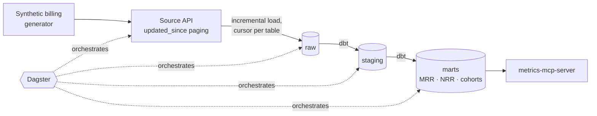

# SaaS Metrics Platform

[](https://github.com/Itsraza099/saas-metrics-platform/actions/workflows/ci.yml)

An ELT pipeline that turns a SaaS company's billing data into the revenue metrics a
finance team reports on: **MRR, ARR, NRR, GRR, ARPA and cohort retention**.

> **Status:** scaffolded. The data generator and dbt staging layer exist; loading, marts and
> the Dagster–dbt wiring are next.

## Architecture



## Quick start

Needs [uv](https://docs.astral.sh/uv/) and Docker (or a local Postgres 16).

```bash
cp .env.example .env
make install
make db          # start Postgres
make dbt-parse   # check the dbt project compiles
make dagster     # open http://localhost:3000
make check       # lint, type check, tests
```

## Break it on purpose

Planned demos, each showing a safety mechanism catching a problem:

- [ ] Run the same load twice → row counts don't change (idempotent loads)
- [ ] Insert a duplicate customer into `raw` → dbt `unique` test fails
- [ ] Stop loading for two days → source freshness check errors
- [ ] Rename a column upstream → model contract fails before bad data reaches marts

## Learning notes

- [Decision records](docs/decisions/)
- [Glossary](docs/glossary.md)
- [Interview check](docs/interview-check.md)

## Related repos

- [metrics-mcp-server](https://github.com/Itsraza099/metrics-mcp-server) lets an AI assistant query these marts through a read-only role.
