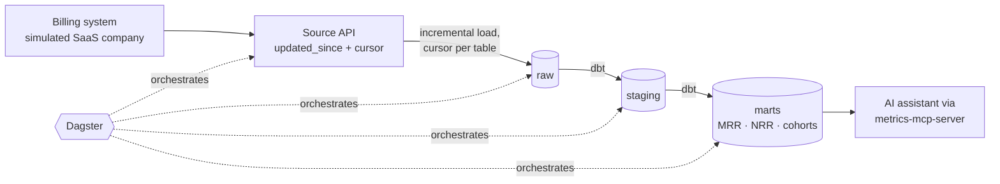

# SaaS Metrics Platform

**The revenue numbers a SaaS finance team reports on, built the way a data team would.**
An ELT pipeline that turns raw billing data into tested, documented **MRR, ARR, NRR, GRR,
ARPA and cohort retention**.

[](https://github.com/Itsraza099/saas-metrics-platform/actions/workflows/ci.yml)


<!-- Add here once built: link to dbt docs (lineage graph) on GitHub Pages, and a dashboard screenshot. -->

| | |
|---|---|
| **Problem** | Revenue metrics computed ad hoc in spreadsheets disagree with each other and nobody can say why. |
| **Solution** | One pipeline with layered models, a stated grain for every table, and tests that fail before bad numbers reach a report. |
| **Shows** | ELT, incremental loads with cursors, dimensional modelling, slowly changing dimensions, data contracts, freshness checks, orchestration |
| **Stack** | Python · dbt · Dagster · Postgres · Docker · GitHub Actions |

## Architecture



| Layer | What happens | Example |
|---|---|---|
| `raw` | Every version of every record, as received, never edited | `raw.invoices` |
| `staging` | Renamed, typed, one model per source table, tested | `stg_invoices` |
| `marts` | Facts and dimensions, each with a stated grain | `fct_mrr_monthly`: one row per customer per month |

## Engineering highlights

- **Incremental, append-only loads.** Each run fetches only what changed since a stored
  watermark, keeps every version of every record, and commits page by page, so re-runs add
  nothing and a crash resumes where it stopped.
  ([load.py](src/saas_metrics/load.py), [decision 0002](docs/decisions/0002-incremental-loading.md))
- **A source that really changes.** A simulated billing system advances day by day, with
  sign-ups, upgrades, churn, monthly invoices and failed payments that get retried, so the
  pipeline is tested against realistic updates, not a static file.
- **Every table states its grain** (what one row means), and its primary key is tested for
  uniqueness and nulls. ([staging tests](transform/models/staging/_staging.yml))
- **Source freshness checks** warn after 24 hours without new data and fail after 48.
- **Customer history is preserved** *(in progress)* with dbt snapshots (slowly changing
  dimension type 2), so last year's MRR still adds up after a customer changes plan.
- **Why dbt + Dagster + Postgres** and not Airflow or DuckDB:
  [decision 0001](docs/decisions/0001-stack-and-layers.md).

## Proving it's correct

| Break it on purpose | What catches it | Status |
|---|---|---|
| Run the same load twice | Second run inserts 0 rows (checked in CI) | ✅ tested |
| Network drops on page 3 of a load | Pages 1–2 kept; next run resumes, no duplicates | ✅ tested |
| Plant a subscription with plan `enterprise` in `raw` | dbt `accepted_values` test fails the build | ✅ demonstrated |
| Stop loading for two days | Source freshness check errors | check configured |
| Rename a column upstream | Model contract fails before marts are touched | planned |

## Build progress

- [x] Simulated billing system and source API with cursor paging
- [x] Incremental, append-only loader with watermarks and a run log
- [x] dbt staging (latest version per record) with tests and freshness checks
- [x] Dagster assets: loads linked to dbt models, daily schedule
- [x] CI runs the whole pipeline against Postgres on every push
- [ ] Marts: `fct_mrr_monthly`, `fct_revenue_kpis_monthly`, `fct_cohort_retention`, `dim_customers`
- [ ] dbt docs and metrics dashboard published to GitHub Pages

## How I worked

Each choice has a [decision record](docs/decisions/); the [glossary](docs/glossary.md) is my
own explanation of each concept with examples from this repo.

**Part of a portfolio:** [metrics-mcp-server](https://github.com/Itsraza099/metrics-mcp-server)
lets an AI assistant query these marts through a read-only role. See all projects on
[my profile](https://github.com/Itsraza099).

<details>
<summary><b>Run locally</b></summary>

Needs [uv](https://docs.astral.sh/uv/) and Docker.

```bash
cp .env.example .env
make install
make db          # start Postgres
make simulate DAYS=700   # build ~2 years of company history
make pipeline    # incremental load, then dbt build + tests
make simulate    # advance a month...
make pipeline    # ...and load only what changed
make dagster     # open http://localhost:3000
make check       # lint, type check, tests
```
</details>
